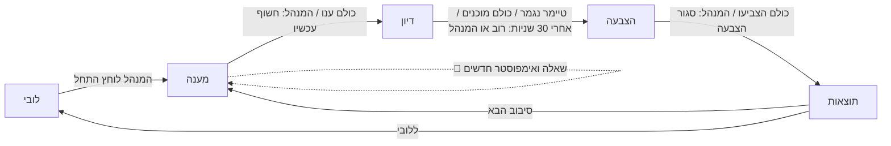
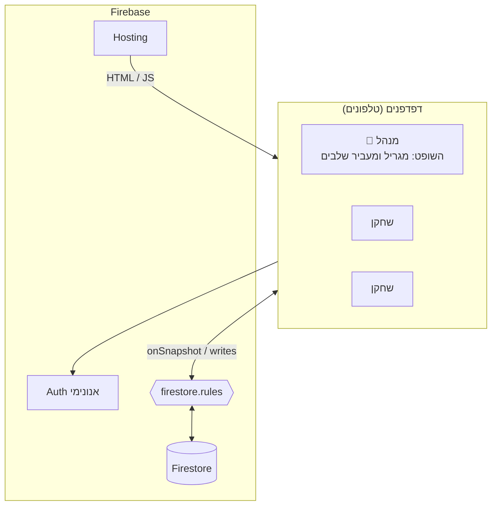

<div align="center">

# מי האימפוסטר? 👀

**משחק מסיבות לטלפון: כולם מקבלים אותה שאלה. כמעט כולם.**

[**▶ לשחק עכשיו**](https://imposter-c9f06.web.app) · [מהלך המשחק](#מהלך-המשחק) · [ארכיטקטורה](#ארכיטקטורה) · [התקנה](#התקנה-ופריסה)


-success)

</div>

---

## על המשחק

כל שחקן מקבל שאלה סודית ועונה עליה. אחד השחקנים, האימפוסטר, מקבל שאלה **דומה אבל שונה**, למשל "כמה שעות אתה ישן?" מול "כמה שעות אתה על הטלפון?". אחרי שכולם ענו, התשובות והשאלה המקורית נחשפות, מתווכחים, ומצביעים מי האימפוסטר.

- **בלי התקנה:** נכנסים מהדפדפן בטלפון עם קוד בן 4 אותיות או QR.
- **3 שחקנים ומעלה**, עם בנק של 300 זוגות שאלות, ואפשר גם לכתוב זוג משלכם.
- **עמיד לניתוקים:** טלפון שננעל לא תוקע את המשחק, ותפקיד המנהל עובר אוטומטית.
- **הסודות מוגנים בשרת:** אי אפשר לגלות את השאלה של אחר או מי האימפוסטר דרך DevTools (ראו [מודל האבטחה](#מודל-אבטחה)).

---

## מהלך המשחק



| שלב | מה רואים | מעבר לשלב הבא |
|---|---|---|
| **לובי** | קוד חדר, QR ורשימת שחקנים. המנהל בוחר זמן דיון (1 עד 5 דקות, ברירת מחדל 2) ויכול לכתוב זוג שאלות משלו | המנהל לוחץ "התחל". צריך לפחות 3 שחקנים מחוברים |
| **מענה** | כל שחקן רואה רק את השאלה שלו. המנהל יכול ללחוץ 🔄 אם השאלה כבר הייתה: זה מגריל זוג שאלות **ואימפוסטר** חדשים, ובונה מחדש את רשימת המשתתפים מהשחקנים המחוברים באותו רגע | אוטומטית כשכל המחוברים ענו, או כשהמנהל לוחץ "חשוף עכשיו" |
| **דיון** | השאלה של כולם, כל התשובות וטיימר | הטיימר נגמר. לפני כן: ב-30 השניות הראשונות רק אם **כל** המחוברים לחצו "מוכן להצביע", ואחריהן מספיק **רוב**. גם הכפתור "עבור להצבעה עכשיו" של המנהל נפתח רק אחרי 30 שניות |
| **הצבעה** | הצבעה סודית. אי אפשר להצביע לעצמך | אוטומטית כשכל המחוברים הצביעו, או כשהמנהל סוגר |
| **תוצאות** | מי הודח, מי היה האימפוסטר, שתי השאלות, מי הצביע למי וטבלת ניקוד | המנהל מתחיל סיבוב חדש או חוזר ללובי |

### ניקוד

| אירוע | נקודות |
|---|---|
| הצבעת לאימפוסטר | **+1** |
| היית האימפוסטר ולא הודחת | **+2** |
| תיקו בהצבעה | אף אחד לא מודח, והאימפוסטר מקבל +2 |

### הגרלת האימפוסטר

האימפוסטר נבחר רק מבין השחקנים **המחוברים**, בהגרלה משוקללת:

$$w_i = (1 + \text{rounds since player } i \text{ was impostor})^2$$

הספירה מתעדכנת רק לשחקנים שהשתתפו בסיבוב. שחקן שעוד לא השתתף באף סיבוב (למשל הצטרף באמצע המשחק) לא היה אימפוסטר אף פעם, ולכן מקבל את הספירה הגבוהה ביותר בחדר.

כך מצטמצמים רצפים ארוכים בלי להיבחר, וההגרלה נשארת לא צפויה. בסימולציה של 6 שחקנים ו-6 סיבובים:

| שיטה | שחקן שלא היה אימפוסטר אף פעם | אותו אימפוסטר פעמיים ברצף |
|---|---|---|
| אקראי אחיד | 33% | 16.7% |
| **משוקלל (בשימוש)** | **18%** | **2.2%** |

זוג שאלות לא חוזר באותו חדר עד שהבנק נגמר. החלפת שאלה ב-🔄 לא נספרת כסיבוב.

---

## ארכיטקטורה

אין שרת. כל הלוגיקה רצה בדפדפן, ו-Firestore משמש גם מסד נתונים, גם ערוץ סנכרון בזמן אמת וגם שכבת הרשאות.



**הדפדפן של המנהל הוא השופט.** הוא מגריל את השאלה ואת האימפוסטר, כותב לכל שחקן את השאלה הסודית שלו, ומעביר שלבים. שאר השחקנים רק קוראים את מצב החדר וכותבים את הפעולות של עצמם: תשובה, "מוכן" והצבעה.

### מודל נתונים

```
rooms/{CODE}                   מצב החדר, קריא לכל שחקן
│   hostUid, phase, round, participants, discussionSec, createdAt,
│   discussionStartedAt, discussionEndsAt, normalQuestion, result, impSince, skipped, hostSeenAt
│   (usedQ: שדה ישן, נמחק בתחילת כל סיבוב. היום הרשימה נשמרת ב-hostOnly)
│
├── players/{uid}              name, score, joinedAt, seenAt,
│                              answeredRound, readyRound, votedRound
├── secrets/{uid}              { round, q }: השאלה של השחקן, קריאה רק לו
├── hostOnly/state             { round, impostorUid, normalQ, impQ, usedQ }: רק למנהל
├── answers/{uid}              { round, text, name, at }: נעול בזמן המענה
└── votes/{uid}                { round, target }: גלוי רק בשלב התוצאות
```

### נוכחות והעברת מנהל

| מנגנון | ערך | מטרה |
|---|---|---|
| פעימת מנהל (`hostSeenAt`) | כל 10 שניות | סימן שהמנהל פעיל |
| פעימת שחקן (`seenAt`) | כל 15 שניות | זיהוי מי מחובר |
| שחקן מנותק | אחרי 30 שניות בלי פעימה | לא עוצר מעבר שלב, לא נכנס לסיבוב הבא ולא מקבל כתר. עדיין אפשר להצביע נגדו |
| השתלטות על תפקיד המנהל | אחרי 30 שניות, ועוד 15 שניות לכל מועמד בתור | המשחק ממשיך גם כשהמנהל נעלם. התור לפי ותק נקבע בלקוח בלבד, והשרת לא אוכף אותו |

- **מנהל שיוצא (🚪)** מעביר את הכתר לשחקן המחובר הוותיק ביותר. אם לא נשאר אף אחד מחובר, החדר **נמחק** עם כל התוכן שלו.
- **חדר שכולם פשוט סגרו בו את הטלפון**, בלי ללחוץ 🚪, **לא נמחק** ונשאר במסד עם התשובות, ההצבעות והסודות שלו (כמה KB לחדר).
- **מנהל שהטאב שלו היה ברקע** מחכה עד 16 שניות לעדכון טרי מהשרת לפני שהוא מעביר שלב, כדי לא לדלג על שחקנים שנראים "מנותקים" רק כי המידע ישן. אם העדכון לא מגיע בזמן הזה (רשת איטית), הוא ממשיך עם המידע שיש לו.
- **זיהוי נוכחות לא תלוי בשעון של מכשיר אחר.** כל טלפון מודד מתי *הוא* ראה את הפעימה של כל שחקן משתנה.

### מודל אבטחה

הסודות נאכפים בשרת, ב-[`firestore.rules`](firestore.rules), ולא בקוד הלקוח:

| מה מוגן | איך |
|---|---|
| השאלה של כל שחקן | `secrets/{uid}` קריא רק לבעליו |
| זהות האימפוסטר והשאלות שכבר היו | `hostOnly` קריא רק למנהל |
| תשובות | חסומות לקריאה כל עוד שלב המענה פתוח |
| הצבעות | גלויות רק למנהל ובשלב התוצאות |
| ניקוד | שחקן יכול לעדכן אצלו רק שדות סטטוס, לא ניקוד |
| מעבר שלבים | רק המנהל |
| השתלטות על תפקיד המנהל | רק שחקן ששלח פעימה ב-30 השניות האחרונות, ורק כשהמנהל יצא או לא שלח פעימה 30 שניות, לפי שעון השרת. כל שחקן מחובר יכול להשתלט, לא רק הבא בתור |
| מחיקת חדר | רק המנהל, ורק אחרי מעבר לשלב `closing` |

> [!NOTE]
> **מגבלה ידועה:** המנהל הוא השופט, ולכן הוא יכול טכנית לגלות מי האימפוסטר דרך DevTools. זה כולל גם מי שקיבל את הכתר באמצע סיבוב, ולכן גם שחקן שמשתלט מ-DevTools ברגע שהמנהל לא מגיב 30 שניות. בין חברים זה בסדר. הגנה מלאה דורשת להעביר את ההגרלה ל-Cloud Functions, שמחייבות את תוכנית Blaze בתשלום.

---

## התקנה ופריסה

### דרישות

- חשבון Google ופרויקט [Firebase](https://console.firebase.google.com). התוכנית החינמית Spark מספיקה.
- Node.js, בשביל `firebase-tools`.

### הקמה (פעם אחת)

1. **Authentication** ← Sign-in method ← הפעל **Anonymous**.
2. **Firestore Database** ← Create database ← **Production mode**. האזור `eur3` מומלץ.
3. **Project settings** ← Your apps ← הוסף **Web app** (`</>`) ← העתק את הערכים של `firebaseConfig` אל [`public/firebase-config.js`](public/firebase-config.js).
4. עדכן את מזהה הפרויקט ב-[`.firebaserc`](.firebaserc).
5. פרוס:

```bash
npm i -g firebase-tools
firebase login
firebase deploy
```

האתר יעלה בכתובת `https://<PROJECT_ID>.web.app`.

> [!TIP]
> `apiKey` שב-`firebase-config.js` אינו סוד, הוא רק מזהה את הפרויקט. מה שמגן על הנתונים הם ה-rules.

### עדכונים

| מה השתנה | פקודה |
|---|---|
| קוד או שאלות (`public/`) | `firebase deploy --only hosting` |
| כללי אבטחה (`firestore.rules`) | `firebase deploy --only firestore:rules` |
| שניהם | `firebase deploy` |

### פיתוח מקומי

**עם אמולטור** (דורש Java). הפקודה מבודדת לגמרי מהפרויקט האמיתי:

```bash
firebase emulators:start      # http://localhost:5000
```

**בלי Java.** הקוד המקומי רץ מול הפרויקט האמיתי, עם ה-rules שכבר הועלו:

```bash
python -m http.server 8123 --directory public    # http://127.0.0.1:8123
```

כדי לבדוק עם כמה שחקנים, פותחים חלון רגיל וחלון גלישה בסתר, או דפדפנים שונים. כל אחד מהם מתחבר כשחקן נפרד.

---

## מבנה הפרויקט

```
impostor/
├── public/
│   ├── index.html            מעטפת הדף
│   ├── app.js                כל הלוגיקה, המצב והמסכים
│   ├── questions.js          בנק השאלות (300 זוגות)
│   ├── style.css             עיצוב (mobile-first, RTL)
│   └── firebase-config.js    פרטי החיבור לפרויקט
├── e2e/                      סביבת Node עם Firebase SDK לסקריפטי בדיקה ידניים (עדיין בלי בדיקות אוטומטיות)
├── firestore.rules           כללי אבטחה
├── firebase.json             הגדרות Hosting ואמולטור
└── .firebaserc               מזהה הפרויקט
```

### הוספת שאלות

כל זוג ב-[`questions.js`](public/questions.js) בנוי כך:

```js
{ q: "כמה שעות אתה ישן בלילה רגיל?", imp: "כמה שעות ביום אתה על הטלפון?" },
```

**זוג טוב** הוא זוג ששתי השאלות בו מייצרות תשובות מאותו סוג ובאותו טווח, למשל שתיהן מספר או שתיהן מקום. כך האימפוסטר יכול להשתלב, אבל לפעמים התשובה שלו "קצת לא מסתדרת".

---

## רעיונות להמשך

- [ ] **הזדמנות אחרונה:** אימפוסטר שנתפס מנחש את השאלה הרגילה ומקבל בונוס
- [ ] שני אימפוסטרים כשיש 7 שחקנים ומעלה
- [ ] יצירת זוגות שאלות עם AI
- [ ] קטגוריות שאלות לבחירה בלובי
